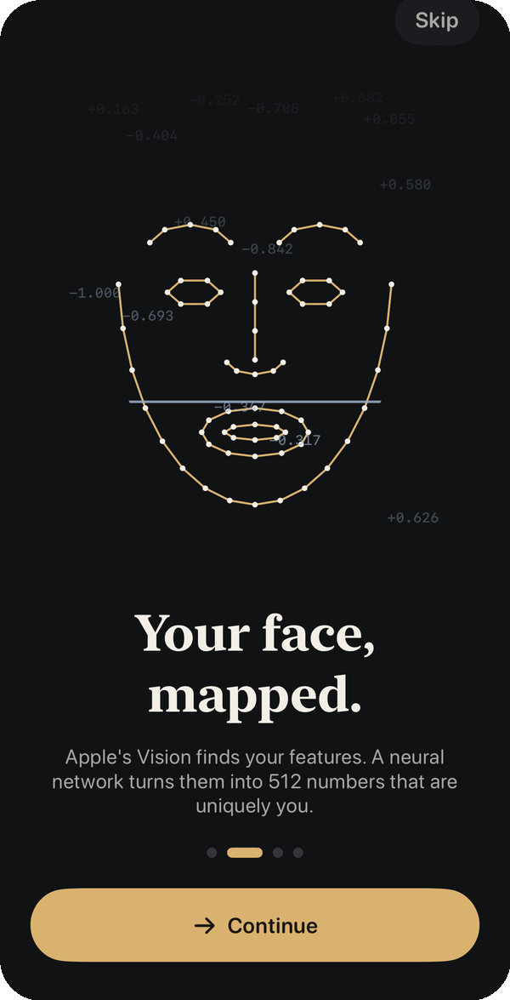
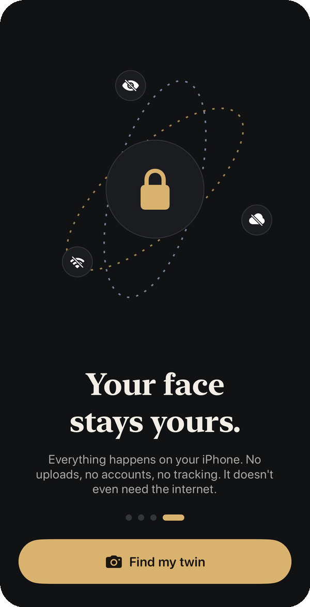

<p align="center">
  
</p>

<h1 align="center">Twinly</h1>

<p align="center">
  <b>Find your famous twin, entirely on your iPhone.</b><br>
  Take a selfie and Twinly finds the actors you look most like out of 9,675 film and TV faces worldwide.<br>
  No server, no account, no upload. Nothing leaves the phone.
</p>

<p align="center">
  
  
  
  
  
</p>

> [!IMPORTANT]
> **Not for commercial use.** Twinly is a portfolio project. The source code is released under the
> [PolyForm Noncommercial License 1.0.0](LICENSE.md), and the face-recognition model it relies on
> (InsightFace) is licensed for non-commercial research only. Don't publish it on an app store,
> sell it, or use it in a commercial product.

<p align="center">
  
  &nbsp;&nbsp;
  
</p>

## What this project shows

I built Twinly end to end: the model conversion, the data pipeline, the matching engine, the
interface and the icon. Highlights:

- **On-device machine learning, done properly.** Face detection and landmarks from Apple's Vision.
  A five-point similarity warp onto the ArcFace template. An ArcFace MobileFaceNet that I converted
  from ONNX to a 6.6 MB FP16 Core ML model, with the normalisation built into the model's input.
  Flip test-time augmentation and L2 normalisation, then a single Accelerate matrix multiply ranks
  every actor at once.
- **One pipeline, two platforms.** The iOS app and the macOS indexing tool compile the *same*
  `Twinly/Core` sources. Celebrity embeddings and your selfie go through identical geometry, so
  nothing drifts between index time and run time.
- **A calibrated score, not raw cosine similarity.** At index time every actor is matched against
  every other one (leave-one-out, in blocks so the 9,675 × 9,675 matrix is never held in memory).
  The 101 quantiles of that distribution map a similarity to a "% match" that means something,
  and the mapping only goes up as similarity does, so it can never contradict the ranking.
- **A real data-engineering pipeline.** Wikidata (through the QLever SPARQL mirror) supplies a
  worldwide actor list ranked by how many Wikipedia language editions cover each person. Filters
  keep it to screen actors. Wikimedia Commons supplies freely licensed portraits. The fetcher is
  resumable, caches its metadata, honours `Retry-After`, and asks for standard thumbnail sizes so
  Wikimedia doesn't throttle it.
- **Fast and light at runtime.** Face crops ship as one memory-mapped `faces.pack` (JPEG byte
  ranges listed in `celebs.json`) instead of 10k loose files. Embeddings are a flat
  `Float32` blob.
- **"Match within" film and TV universes.** Limit matching to any mix of 36 universes, including
  Harry Potter, Marvel, Star Wars, Game of Thrones, Friends, Squid Game and Dhoom. Cast lists are
  pulled from Wikidata by following "part of the series" and "media franchise" links. Changing the
  scope re-ranks a result instantly from the stored embedding, without running the model again.
- **Product polish.** An animated four-page onboarding. A live camera that guides your face
  into position and captures by itself once it's steady. A slot-machine reveal. A comparison
  view, and a share card rendered with `ImageRenderer`. Haptics, an "Ink and champagne"
  design-token system, and VoiceOver labels on the key controls.
- **An icon drawn in code.** `tools/icon/make_icon.swift` draws Rubin's-vase twin profiles in
  CoreGraphics, with light, dark and tinted variants for iOS 18 and later.
- **Privacy by construction.** The app contains no networking code at all. Every portrait is
  credited in the app with its photographer, licence and source.

## How it works


| Layer | Where | Notes |
|---|---|---|
| Face pipeline | `Twinly/Core/` | `FaceAligner`, `FaceEncoder`, `CelebrityIndex`. Platform-neutral and shared with the indexer. |
| Engine | `Twinly/Engine/LookalikeEngine.swift` | Photo → matches, universe scoping, face crops read from the memory-mapped pack. |
| UI | `Twinly/Features/`, `Twinly/DesignSystem/` | SwiftUI with Observation; design tokens in `Theme.swift`. |
| Data tools | `tools/` | Python (standard library only) for Wikidata and Commons; a Swift CLI indexer; the model converter. |

## The reference set

The 10,000 most widely covered film and TV actors on Wikidata, born after 1925, who have a free
portrait. "Most widely covered" means articles in the most Wikipedia language editions, with at
least 10. The set covers Hollywood, Bollywood, Lollywood, Tollywood, K-drama, Turkish, Nollywood
and more. 9,675 of them pass the indexer's quality checks. The rest are dropped for side profiles,
faces that are too small, no face, or more than one face. Two filters keep the set to screen actors:
- Politicians are dropped unless they're also tagged *film actor*.
- People whose English description doesn't mention acting or film are dropped, because Wikidata tags
  popes and heads of state as "actor" for a single cameo.

## Build it yourself

The model weights and the generated celebrity data are **not in this repository**. The weights'
licence doesn't cover redistribution, and the data runs to hundreds of MB. The tools rebuild both:

```bash
python3 -m venv .venv && .venv/bin/pip install "coremltools>=8" torch onnx onnx2torch pillow
.venv/bin/python tools/convert_model.py   # downloads InsightFace buffalo_s → Twinly/Resources/FaceEmbedder.mlpackage
python3 tools/fetch_celebs.py             # actors + portraits → tools/cache/celebs/  (resumable; takes hours)
tools/build_index.sh                      # embeddings + face crops → Twinly/Resources/Celebs/
python3 tools/fetch_franchises.py         # optional: refresh the "Match within" universes

xcodegen                                  # project.yml is the source of truth
xcodebuild -scheme Twinly -destination 'platform=iOS Simulator,name=iPhone 17 Pro' build
```

Notes:
- Matching needs a **real iPhone**: Vision's face landmarks don't work properly in the iOS
  Simulator. Debug builds accept `TWINLY_DEMO_IMAGE=/path/to/photo.jpg` to run a photo straight
  away. `TWINLY_ONBOARDING=1` replays the onboarding.
- Wikidata's own SPARQL endpoint times out on queries this size, so the fetcher uses QLever's
  mirror.
- Commons metadata comes through `en.wikipedia.org`'s API, because `commons.wikimedia.org`
  is unreachable from some networks.

## Licence and credits

- **Code:** © 2026 M. Afham, released under the [PolyForm Noncommercial License 1.0.0](LICENSE.md).
  You may use, study and modify it for any non-commercial purpose. Commercial use is not permitted.
- **Face model:** ArcFace MobileFaceNet (`w600k_mbf`) from
  [InsightFace](https://github.com/deepinsight/insightface). The pretrained weights are for
  non-commercial research use only and are downloaded by `tools/convert_model.py`, not
  redistributed here.
- **Portraits:** freely licensed images from Wikimedia Commons under each file's own licence
  (CC BY, CC BY-SA, CC0 and others). Every one is credited in the app (Result screen, and
  About → Photo credits).
- **Names and franchise data:** Wikidata (CC0).

Twinly isn't affiliated with or endorsed by any actor, studio or franchise named in the app. Resemblance
scores are for fun and say nothing about identity.

---

<p align="center">Designed and built by <a href="https://mafham.dev">M. Afham</a>, iOS and macOS developer.</p>
